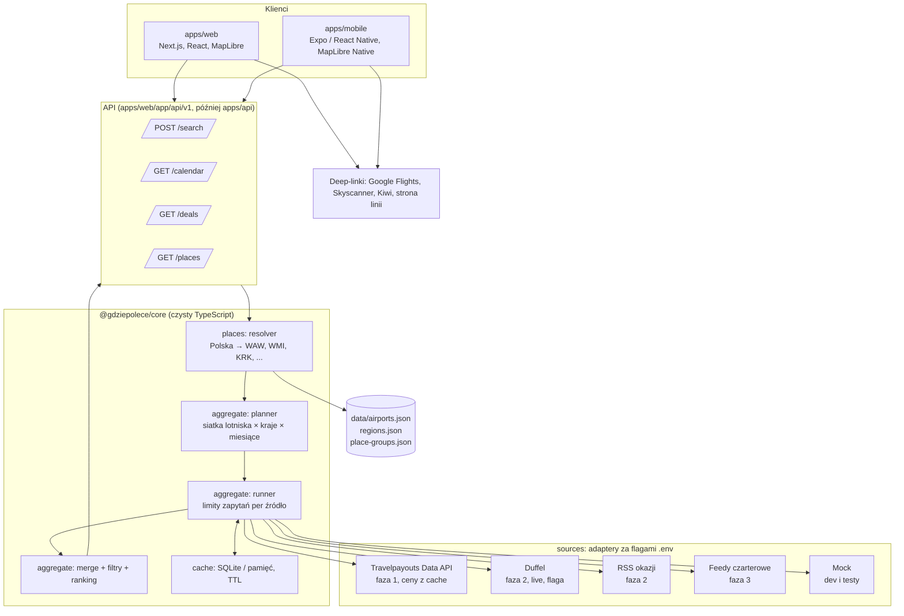

# Architektura

Wersja wizualna z makietami ekranów: artefakt "Gdzie Polecę Architektura" (link w rozmowie).

## Warstwy

## Przepływ zapytania "Polska → Azja, najbliższe 8 miesięcy"

1. Klient wysyła `SearchQuery`: origins=[country:PL], destinations=[continent:AS], window=8 miesięcy, filtry.
2. Resolver rozwija PL na lotniska z ruchem rozkładowym (15) i AS na listę krajów (49). Domyślnie (`filters.excludeOriginCountries`) cele w kraju wylotu odpadają: w planie i w filtrach wyników "gdziekolwiek"; wyjątek: zapytanie w całości krajowe (Kraków → Gdańsk).
3. Planner buduje siatkę (źródło × lotnisko wylotu × kubełek celu × miesiąc) z twardym limitem zadań (`SEARCH_MAX_TASKS`, domyślnie 500). Dla każdego źródła liczy rozmiar siatki każdej strategii, którą źródło obsługuje: po kubełku na lotnisko, na miasto z kilkoma lotniskami (`cityDestination`, grupy `<KOD>-city`, np. TYO = NRT + HND), na cały kraj (`countryDestination`) i jeden kubełek "gdziekolwiek" filtrowany lokalnie (`anywhere`). Wybiera najtańszą strategię nazwaną (lotnisko / miasto / kraj), która mieści się w udziale źródła w limicie (remis → bardziej szczegółowa); gdy żadna się nie mieści — "gdziekolwiek"; wybór i koszty alternatyw są w `SearchPlan.strategies`. Polska → Tokio na rok: 15 × 1 × 13 = 195 zadań (kubełek miasta) zamiast 390; PL → AS: "gdziekolwiek" (195). Zadania jednego (źródło × wylot × kubełek) z kilku miesięcy niosą `spanMonths`; Travelpayouts pyta wtedy `/v2/prices/latest` raz na cały okres (`period_type=year`). Gdy trzeba przyciąć, odpadają najdalsze miesiące, a ostrzeżenie mówi, do kiedy pokazano loty.
4. Runner wykonuje zadania równolegle z limitem na źródło (token bucket), najpierw sprawdzając cache.
   Open-jaw (`allowOpenJaw` przy podróży w obie strony) dodaje dwie fazy: (1) razem z planem głównym loty w jedną stronę lotniska wylotu → cele; (2) dla 40 najtańszych lotnisk docelowych z fazy 1 loty w jedną stronę cel → lotniska wylotu w datach zgodnych z długością pobytu (osobny limit zadań). Pary A→X + X→B (B ≠ A) łączy `combineOpenJaw`; oferta ma dwa `legs` z osobnymi linkami, pusty `deepLink` i konkuruje w rankingu z lotami w obie strony.
5. Merge dedupluje oferty (ten sam origin, cel, data wylotu i powrotu, lotnisko powrotu; bez względu na przewoźnika), zostawia najtańszą, zapamiętuje wszystkie źródła w `sources`.
6. Filtry i ranking budują listę `DestinationSummary`: cel, najtańsza oferta, liczba ofert, histogram cen.
7. API odsyła wynik; klient pokazuje listę, mapę i kalendarz. Każda oferta ma wiek ceny i deep-link do weryfikacji.

## Kontrakt API (faza 1)

| Endpoint | Wejście | Wyjście |
|---|---|---|
| `POST /api/v1/search` | `SearchQuery` | `{ destinations: DestinationSummary[], meta: { sources, tasks, cacheHits, tookMs } }` |
| `GET /api/v1/calendar?from=POZ&to=BKK&month=2027-03` | lotniska/miasta, miesiąc | ceny dzień po dniu, bezpośrednie vs z przesiadką |
| `GET /api/v1/places?q=pozn` | tekst | podpowiedzi: lotniska, miasta, kraje, regiony, grupy |
| `GET /api/v1/deals?from=PL` | miejsce wylotu | okazje z feedów (faza 2) |

Typy żądań i odpowiedzi żyją w `packages/api-client` i są importowane przez oba klienty.

## Web i mobile

- Web: Next.js. Trzy strefy na desktopie (formularz, lista, mapa), na telefonie zakładki Lista / Mapa.
- Mobile: Expo (React Native) w fazie 3. Współdzieli `@gdziepolece/core` (typy, resolver do podpowiedzi offline) i `packages/api-client`. Nie współdzieli komponentów UI; ekrany są natywne.
- Jeden backend dla obu. Gdy mobile wejdzie, API zostaje wydzielone do `apps/api` bez zmiany kontraktu.

## Wzorzec formularza

Formularz działa jak planer podróży miejskiej i jest podzielony na zwijane sekcje z nagłówkiem i
jednozdaniową podpowiedzią (zwinięta sekcja pokazuje podsumowanie swoich wartości):

1. **Trasa** — skąd (lotnisko, miasto, kraj, region, grupa) i dokąd (to samo lub „gdziekolwiek”;
   puste pole = cały świat).
2. **Termin** — zakres dat wylotu (presety „Najbliższy miesiąc” … „Rok” zsynchronizowane z suwakiem
   miesięcy albo dokładne daty), długość pobytu lub lot w jedną stronę, dni tygodnia wylotu.
3. **Lot** — przesiadki (bez / max 1 / dowolnie), maks. czas lotu, typ linii, linie lotnicze z
   wyników (odznaczenie wyklucza linię), godziny wylotu i przylotu (czas lokalny, każdy odcinek).
4. **Cena i aktualność** — cena maksymalna w zł, dopuszczalny wiek ceny (domyślnie do 7 dni, opcjonalnie tylko do 48 h).
5. **Zaawansowane** — open-jaw, multicity (wkrótce), pomijanie kierunków w kraju wylotu.

Na start otwarte są Trasa i Termin; „Szukaj” jest przyklejony do dołu kolumny formularza. Nad
wynikami stoi jednowierszowe podsumowanie wyszukiwania („Polska → gdziekolwiek · pół roku · 7–21 dni ·
max 1 przesiadka · ceny do 7 dni”, wartości domyślne pominięte). Wynik to lista posortowana po cenie
obok mapy z łukami tras od lotnisk wylotu do kierunków z listy; na węższych ekranach lista i mapa są
zakładkami, a na telefonie formularz staje się arkuszem. Pusty stan proponuje przykładowe
wyszukiwania, które wypełniają formularz i od razu szukają. Szczegóły: `apps/web/README.md`, „Układ
ekranu”.
